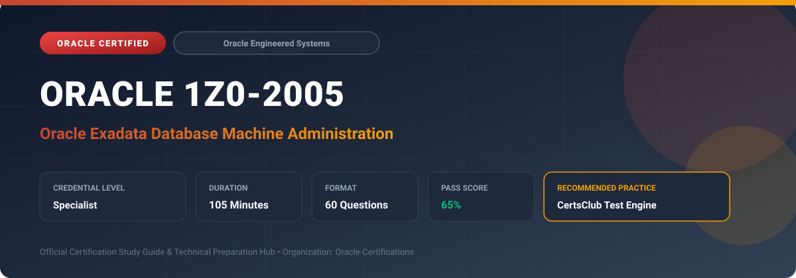

  

# Oracle 1Z0-2005: Oracle Exadata Database Machine Administration

---

## 1. Exam Overview & Candidate Profile

The **Oracle 1Z0-2005: Oracle Exadata Database Machine Administration** credential certifies professionals who demonstrate technical mastery, architectural competence, and hands-on operational capability in this certification domain.

Candidates validate comprehensive knowledge and expertise required to design, configure, manage, and optimize mission-critical Oracle environments across cloud, on-premises, and hybrid architectures.

### Target Audience & Prerequisites
- **Target Roles**: Implementation Specialists, Cloud Architects, Technical Leads, Enterprise Consultants, and Systems Engineers.
- **Recommended Experience**: 1–2 years of practical, hands-on experience designing, implementing, and maintaining corresponding Oracle solutions.
- **Credential Earned**: Specialist Certification.

---

## 2. Key Exam Specifications

| Specification | Details |
| :--- | :--- |
| **Exam Code** | **Oracle 1Z0-2005** |
| **Official Title** | Oracle Exadata Database Machine Administration |
| **Certification Track** | Oracle Engineered Systems |
| **Exam Duration** | 105 Minutes |
| **Number of Questions** | 60 Questions |
| **Passing Score** | 65% |
| **Question Format** | Multiple Choice (Single/Multiple Answer), Scenario-Based Questions |
| **Delivery Provider** | Oracle University / Pearson VUE (Online Proctored or Test Center) |
| **Recommended Practice Engine** | [CertsClub Oracle Practice Tests](https://www.certsclub.com/oracle/1z0-2005-dumps.html) |

---

## 3. Official Blueprint & Exam Domain Breakdown

The examination assesses candidate competencies across core functional domains weighted as follows:

| Domain Area | Weighting |
| :--- | :--- |
| **Exadata Architecture (Storage Servers, DB Nodes, RoCE/IB)** | `25%` |
| **Smart Scan Offload, Hybrid Columnar Compression & Storage Indexes** | `25%` |
| **Exadata Smart Flash Cache, Flash Log & PMEM Architecture** | `20%` |
| **Exadata Maintenance, Patching (dcli, patchmgr) & Monitoring** | `15%` |
| **Exadata Cloud Service (ExaCS) & Cloud@Customer Deployment** | `15%` |

---

## 4. Deep Dive into Complex & Challenging Technical Topics

To secure a passing score on the 1Z0-2005 exam, candidates must master the following advanced concepts:

- Deconstructing Exadata hardware: Database Compute Nodes, Exadata Storage Servers (Cells), RoCE v2 / InfiniBand fabric, and ILOMs.
- Leveraging Smart Scan SQL offload: column projection, row filtering, bloom filters, and Storage Indexes to eliminate I/O.
- Maximizing compression ratios with Hybrid Columnar Compression (Warehouse and Archive compression levels).
- Optimizing memory and caching hierarchies: Exadata Smart Flash Cache (Write-Through vs Write-Back), Flash Log, and Persistent Memory (PMEM).
- Executing automated multi-node rolling patches using `patchmgr`, diagnostic tools (`sundiag`, `exachk`), and cell management with `cellcli`.

---

## 5. Scenario-Based Demo & Practice Questions

### Question 1
What core Exadata feature offloads SQL processing (such as predicate evaluation and column selection) directly to the storage cells, returning only filtered rows and requested columns to compute nodes?

A) Smart Scan
B) Automatic Indexing
C) In-Memory Column Store
D) Fast Refresh Materialized Views

- **Correct Answer**: `A) Smart Scan`  
- **Technical Explanation**: Smart Scan evaluates SQL `WHERE` clause predicates directly on Exadata Storage Servers, transmitting only matching rows and requested columns across the storage network fabric.

---

### Question 2
Which utility is used by Exadata administrators to orchestrate automated, non-disruptive rolling firmware, OS, and cell software updates across all storage cells?

A) patchmgr
B) yum install -y
C) rpm -Uvh
D) cellcli --force-update

- **Correct Answer**: `A) patchmgr`  
- **Technical Explanation**: `patchmgr` is the official Exadata patching utility that automates rolling pre-checks, firmware updates, and software installations across database nodes and storage servers.

---

## 6. Recommended Preparation Strategy & Practice Testing Engine

Achieving certification in **Oracle 1Z0-2005** requires balanced theoretical study and scenario-based simulation practice:

1. **Review Oracle Documentation**: Master architecture guides, implementation workbooks, and administration manuals on the Oracle Help Center.
2. **Hands-on Lab Practice**: Execute real-world configuration, policy setup, and troubleshooting tasks in your cloud tenancy or test instance.
3. **Simulated Exam Drills**: Practice answering timed, scenario-based multiple-choice questions to familiarize yourself with the question formats, traps, and timing constraints.

### Practice With CertsClub
For realistic practice questions, updated dumps, and mock testing environments:
- **Resource**: [CertsClub Oracle Practice Test Engine](https://www.certsclub.com/oracle/1z0-2005-dumps.html)
- **Special Discount**: Use coupon code **`club20`** during checkout for an instant **20% discount** on all practice exam bundles and testing engines.

---

## 7. Official Documentation & References

- [Oracle University Certification Registry](https://education.oracle.com/)
- [Oracle Help Center Documentation Portal](https://docs.oracle.com/)
- [Oracle Cloud Infrastructure & Applications Guides](https://docs.oracle.com/en/cloud/)
- [CertsClub Oracle Certification Exam Practice](https://www.certsclub.com/oracle/1z0-2005-dumps.html)

---

## 8. SEO & Discovery Keywords

`oracle 1z0-2005, oracle 1z0-2005 exam, oracle 1z0-2005 dumps, 1Z0-2005 practice questions, 1Z0-2005 study guide, oracle exadata database machine administration, certsclub 1z0-2005`